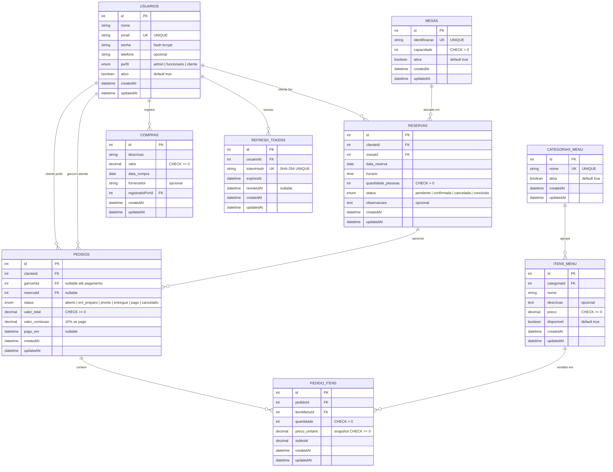

# DER — get-order (Restaurante IOT)

Diagrama entidade-relacionamento alinhado às migrations Sequelize (fonte de verdade do schema).  
Campos e endpoints: [`DOCUMENTACAO.md`](DOCUMENTACAO.md). SQL didático: [`schema_referencia.sql`](schema_referencia.sql).

---

## Relacionamentos

| De | Para | Cardinalidade | FK |
|----|------|---------------|----|
| `usuarios` (cliente) | `reservas` | 1 : N | `reservas.clienteId` |
| `mesas` | `reservas` | 1 : N | `reservas.mesaId` |
| `usuarios` (cliente) | `pedidos` | 1 : N | `pedidos.clienteId` |
| `usuarios` (funcionário/garçom) | `pedidos` | 1 : N | `pedidos.garcomId` |
| `reservas` | `pedidos` | 1 : 0..N (opcional) | `pedidos.reservaId` nullable |
| `categorias_menu` | `itens_menu` | 1 : N | `itens_menu.categoriaId` |
| `pedidos` | `pedido_itens` | 1 : N | `pedido_itens.pedidoId` |
| `itens_menu` | `pedido_itens` | 1 : N | `pedido_itens.itemMenuId` |
| `usuarios` | `compras` | 1 : N | `compras.registradoPorId` |
| `usuarios` | `refresh_tokens` | 1 : N | `refresh_tokens.usuarioId` |

- Um **usuário** autentica todos os papéis (`admin` \| `funcionario` \| `cliente`) na mesma tabela.
- Cada reserva aloca **uma** mesa (`mesaId` obrigatório).
- Pedido pode ou não ter reserva; garçom é obrigatório só no **pagamento**.
- `pedido_itens` guarda preço unitário (snapshot).
- `compras` = despesas (insumos), sem ligação com cardápio.
- `refresh_tokens` guarda hash SHA-256 do refresh (nunca o token em claro); `ON DELETE CASCADE` no usuário.

---

## ENUMs, UNIQUE e CHECK

- **UNIQUE:** `usuarios.email`, `mesas.identificacao`, `categorias_menu.nome`, `refresh_tokens.tokenHash`
- **ENUM:**
  - `usuarios.perfil` → `admin` \| `funcionario` \| `cliente`
  - `reservas.status` → `pendente` \| `confirmada` \| `cancelada` \| `concluida`
  - `pedidos.status` → `aberto` \| `em_preparo` \| `pronto` \| `entregue` \| `pago` \| `cancelado`
- **CHECK:** `mesas.capacidade > 0`; `reservas.quantidade_pessoas > 0`; `itens_menu.preco >= 0`; `pedido_itens` qtd/preço/subtotal ≥ regras; `pedidos.valor_total >= 0`; `pedidos.valor_comissao >= 0`; `compras.valor >= 0`; pedido `pago` exige `garcomId` + `valor_comissao` + `pago_em`
- **Disponibilidade de mesa:** regra na API (não UNIQUE): bloqueia se já houver `pendente`/`confirmada` na mesma mesa + data + horário
- **ON DELETE RESTRICT** nas FKs de domínio (preferir `ativa` / `disponivel` / cancelar)
- **Comissão 10%:** gravada em `pedidos.valor_comissao` ao status `pago`

---

## Diagrama (Mermaid)

### Como ler

- `PK` = chave primária · `FK` = chave estrangeira · `UK` = UNIQUE
- `||--o{` = **um** para **muitos** (1:N)

Visualizar no preview Mermaid do Cursor / VS Code / GitHub.
