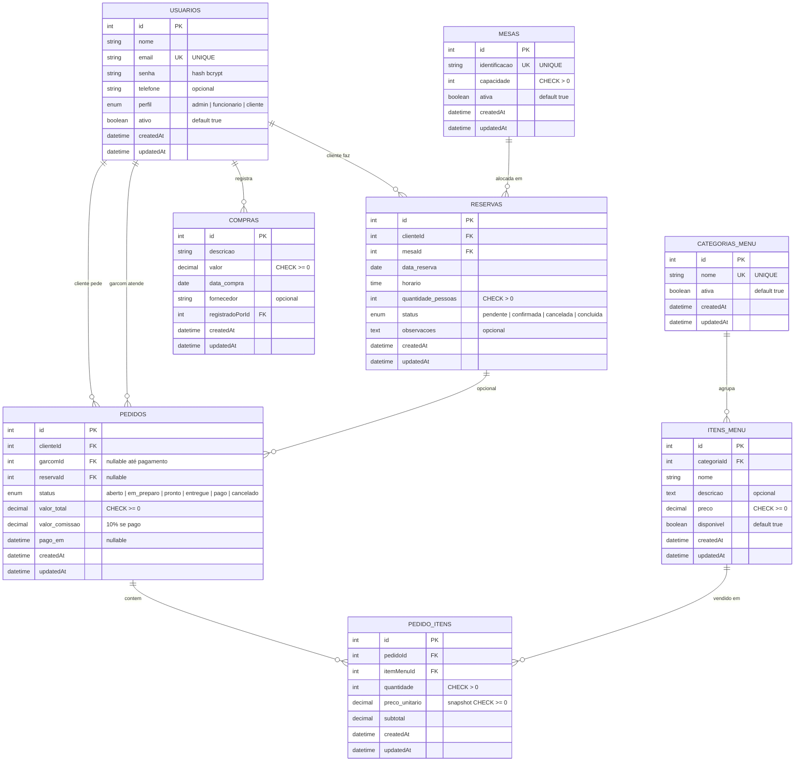

# DER — get-order (Restaurante IOT)

**DER** = Diagrama Entidade-Relacionamento das tabelas previstas para o MVP.  
Fonte de planejamento da Fase 0; na implementação, as **migrations Sequelize** serão a fonte de verdade do schema (como em `web-car-wash`). Detalhe de campos: `docs/MODELO_DADOS.md`. Regras: `docs/FASE0_REGRAS.md`.

---

## Relacionamentos

| De | Para | Cardinalidade | FK |
|----|------|---------------|----|
| `usuarios` (cliente) | `reservas` | 1 : N | `reservas.clienteId` |
| `mesas` | `reservas` | 1 : N | `reservas.mesaId` |
| `usuarios` (cliente) | `pedidos` | 1 : N | `pedidos.clienteId` |
| `usuarios` (funcionário/garçom) | `pedidos` | 1 : N | `pedidos.garcomId` |
| `reservas` | `pedidos` | 1 : 0..N (opcional) | `pedidos.reservaId` nullable |
| `categorias_menu` | `itens_menu` | 1 : N | `itens_menu.categoriaId` |
| `pedidos` | `pedido_itens` | 1 : N | `pedido_itens.pedidoId` |
| `itens_menu` | `pedido_itens` | 1 : N | `pedido_itens.itemMenuId` |
| `usuarios` (admin/funcionário) | `compras` | 1 : N | `compras.registradoPorId` |

- Um **usuário** autentica todos os papéis (`admin` | `funcionario` | `cliente`) na mesma tabela.
- Cliente faz **N** reservas e **N** pedidos.
- Cada reserva aloca **uma** mesa (`mesaId` obrigatório — abordagem A).
- Pedido pode ou não ter reserva; garçom é obrigatório só no momento do **pagamento**.
- `pedido_itens` guarda preço unitário (snapshot) na compra.
- `compras` = despesas (alimentos/insumos), sem ligação com cardápio no MVP.

---

## Regras importantes para apresentar

- **UNIQUE:** `usuarios.email`, `mesas.identificacao`, `categorias_menu.nome`
- **ENUM:**  
  - `usuarios.perfil` → `admin` \| `funcionario` \| `cliente`  
  - `reservas.status` → `pendente` \| `confirmada` \| `cancelada` \| `concluida`  
  - `pedidos.status` → `aberto` \| `em_preparo` \| `pronto` \| `entregue` \| `pago` \| `cancelado`
- **CHECK:**  
  - `mesas.capacidade > 0`  
  - `reservas.quantidade_pessoas > 0`  
  - `itens_menu.preco >= 0`  
  - `pedido_itens.quantidade > 0`  
  - `pedido_itens.preco_unitario >= 0`  
  - `pedidos.valor_total >= 0`  
  - `pedidos.valor_comissao >= 0` (quando preenchido)  
  - `compras.valor >= 0`
- **Disponibilidade de mesa:** regra de negócio na API (não UNIQUE simples): bloquear se já houver reserva `pendente`/`confirmada` na mesma mesa + data + horário.
- **ON DELETE RESTRICT** nas FKs principais (não apagar usuário/mesa/item com filhos). Preferir `ativa`/`disponivel`/`cancelado`.
- **Comissão 10%:** calculada e gravada em `pedidos.valor_comissao` ao status `pago`.

---

## Diagrama (Mermaid)

### Como ler os símbolos

- `PK` = chave primária (`id`)
- `FK` = chave estrangeira
- `UK` = UNIQUE
- `||--o{` = **um** para **muitos** (1:N)

## Onde visualizar

- Preview Markdown com Mermaid no VS Code / Cursor / GitHub.
- Exportar imagem/PDF se a banca pedir artefato visual separado.
